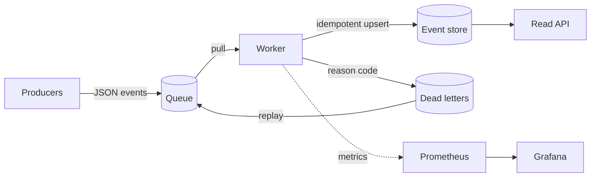

# Streamforge

**An event-driven data platform: ingest, validate, transform, store, serve and observe, with at-least-once delivery, idempotent writes and a replayable dead-letter store.**


> **Status:** the implementation and its test suite are included. The tests, the CI workflow,
> the Docker files and the Terraform were written but **have not been run**, and **no
> benchmarks have been published**. Run `make check` and review the infrastructure before
> relying on any of it.

## Why this exists

Pipelines fail in predictable ways: duplicate deliveries, malformed messages, schema drift,
a database that goes away for a few minutes. Streamforge handles each of these explicitly and
makes the handling visible, so it is a small, readable reference for building a reliable
data platform rather than a framework.

## Features

- **Schema validation at the edge.** An envelope check, then a per-type, per-version JSON
  Schema from a file-based registry. Schemas are versioned and immutable.
- **Composable transforms.** Pure functions chained per event type.
- **At-least-once delivery with idempotent storage.** Redelivery, replay and multiple
  workers are safe because writes are keyed by event id.
- **Dead letters with reason codes** and a replay command that cannot lose messages.
- **Pluggable backends.** In-process queue and in-memory store for tests and demos;
  Google Pub/Sub and PostgreSQL for deployment, behind small interfaces.
- **Read API** (FastAPI) for events and aggregates, plus a Prometheus scrape endpoint.
- **Observability.** Prometheus metrics, optional OpenTelemetry spans, JSON logs,
  a provisioned Grafana dashboard.
- **Data-quality rules** defined in YAML (not-null, range, uniqueness, freshness) with a
  command that exits non-zero on failure.
- **DataOps basics.** Forward-only SQL migrations, a seeded synthetic data generator,
  CI for Python, Terraform and Docker.
- **GCP infrastructure as code.** Terraform for Pub/Sub, Cloud SQL, Cloud Run, Artifact
  Registry and least-privilege IAM.

## Architecture



The core depends on three interfaces (`Queue`, `EventStore`, `DeadLetterStore`). Adapters
implement them for local development and for GCP. See [docs/ARCHITECTURE.md](docs/ARCHITECTURE.md)
for sequence diagrams, failure handling and the GCP deployment, and [docs/adr](docs/adr)
for the design decisions.

## Quick start

Local, with no external services (Python 3.12):

```bash
python -m venv .venv && source .venv/bin/activate
pip install -e ".[dev]"
streamforge run --demo 200 --seed 7
```

This publishes 200 synthetic events (about 5% deliberately invalid) to the in-process queue,
processes them with the in-memory store and prints structured logs.

Other commands:

```bash
streamforge generate --count 10 --seed 1     # synthetic events as JSON lines
streamforge quality                          # evaluate quality rules on the store
make check                                   # ruff, mypy and pytest
```

Full local stack (PostgreSQL, worker, API, Prometheus, Grafana):

```bash
cp .env.example .env        # set POSTGRES_PASSWORD and GRAFANA_ADMIN_PASSWORD
docker compose up --build
```

The API is on `http://localhost:8000`, Prometheus on `:9090` and Grafana on `:3000`. In the
Compose stack the worker generates its own demo events, because the in-process queue is not
shared between containers.

## Read API

| Endpoint | Description |
|---|---|
| `GET /events?type=&limit=` | Newest events first. `limit` is 1 to 500. Needs `X-API-Key` if `SF_API_KEY` is set. |
| `GET /aggregates` | Event counts per type and order totals per currency. Needs `X-API-Key` if `SF_API_KEY` is set. |
| `GET /health` | 200 when the store is reachable, otherwise 503. |
| `GET /metrics` | Prometheus text format. |

## Configuration

All settings are environment variables with the `SF_` prefix. See `.env.example`.

| Variable | Default | Meaning |
|---|---|---|
| `SF_QUEUE_BACKEND` | `local` | `local` or `pubsub` |
| `SF_STORE_BACKEND` | `memory` | `memory` or `postgres` |
| `SF_DATABASE_URL` | none | Required for `postgres`. Treated as a secret. |
| `SF_PUBSUB_PROJECT`, `SF_PUBSUB_TOPIC`, `SF_PUBSUB_SUBSCRIPTION` | none | Required for `pubsub` |
| `SF_MAX_DELIVERY_ATTEMPTS` | `5` | Attempts before a store failure is dead-lettered |
| `SF_BATCH_SIZE` | `100` | Messages per pull |
| `SF_METRICS_PORT` | `9100` | Worker metrics port |
| `SF_API_KEY` | none | Optional shared key for `/events` and `/aggregates`. Treated as a secret. |

The complete list is in [docs/CONFIGURATION.md](docs/CONFIGURATION.md). Commands are in
[docs/CLI.md](docs/CLI.md) and the API in [docs/API.md](docs/API.md).

## Repository layout

```
src/streamforge/      core, adapters, API, CLI
schemas/              versioned JSON Schemas (<type>.v<N>.json)
quality/rules.yaml    data-quality rules
migrations/           forward-only SQL migrations
tests/                unit tests using in-memory adapters
observability/        Prometheus config and Grafana dashboard
infra/terraform/      GCP infrastructure (reviewed, not applied)
docs/                 architecture, data contracts, runbook, ADRs
```

## Documentation

- [Documentation index](docs/index.md)
- [Architecture](docs/ARCHITECTURE.md)
- [Data contracts](docs/DATA_CONTRACTS.md)
- [Configuration](docs/CONFIGURATION.md), [command line](docs/CLI.md) and [read API](docs/API.md)
- [Operations runbook](docs/OPERATIONS.md)
- [Development guide](docs/DEVELOPMENT.md)
- [Infrastructure](infra/terraform/README.md)
- [Architecture decision records](docs/adr)
- [Roadmap](docs/ROADMAP.md) and [security policy](SECURITY.md)

## Development

```bash
pip install -e ".[dev,postgres,pubsub,otel]"
pre-commit install
make check
```

## Limitations

- **Not run or benchmarked.** The code, tests, workflows, Docker files and Terraform have not
  been executed. There are no throughput, latency or reliability measurements.
- **No integration tests.** The PostgreSQL and Pub/Sub adapters are tested only for error
  handling, with fakes. Their real behaviour against a database or broker has not been
  checked, and the PostgreSQL adapter is excluded from the coverage report.
- **One connection per call** in the PostgreSQL adapter, and a synchronous pull loop in the
  worker. Both are simple on purpose and not tuned.
- **No ordering guarantee**, and first write wins on duplicate ids.
- **The local queue is in-process.** It cannot connect separate processes or containers.
- **Schemas load at start-up.** Changing a schema needs a deployment.
- **Dead-letter details can contain payload values** from schema library messages.
  Treat dead letters and logs as sensitive.
- **Migrations are forward-only** with no coordination between concurrent runners.
- **Weak API authentication.** There is none by default. `SF_API_KEY` adds one shared key
  for the data routes. Keep the API behind internal ingress.
- **No pagination cursor.** `/events` only takes a `limit`.
- **The Terraform has not been applied** and assumes an existing VPC with private
  services access.

## Roadmap

The full list is in [docs/ROADMAP.md](docs/ROADMAP.md). The main items:

- Integration tests for PostgreSQL and Pub/Sub using containers or emulators.
- Publish reproducible benchmarks, with the method and hardware stated.
- Kafka-compatible broker adapter for a shared local queue.
- Connection pooling and concurrent message handling.
- OpenTelemetry exporter configuration and trace propagation from producers.
- Cursor pagination, rate limiting and real identity for the API.
- Optional schema hot reload and compatibility checks in CI.

## License

MIT. See [LICENSE](LICENSE).
