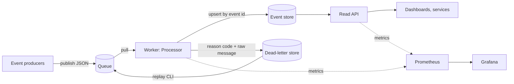
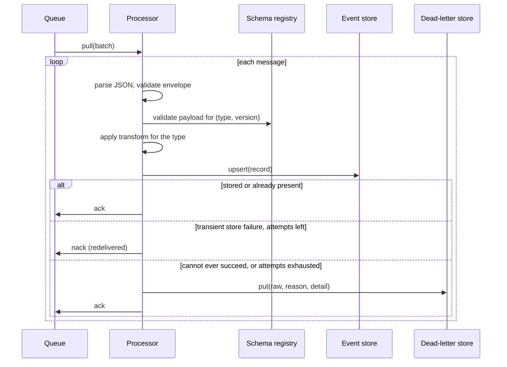
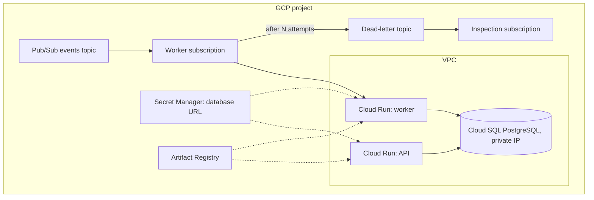

# Architecture

Streamforge moves events through a fixed path: **ingest, validate, transform, store, serve,
observe**. The core is plain Python that depends only on small interfaces (ports). Queues and
databases are adapters, so the same pipeline runs in tests, on a laptop and on GCP.

## System context

## Processing a message

## Components

| Module | Responsibility |
|---|---|
| `domain.py` | Event envelope, stored `Record`, `DeadLetter`, reason codes, errors |
| `registry.py` | Loads `schemas/<type>.v<N>.json` and validates payloads |
| `transform.py` | Pure payload functions composed per event type |
| `pipeline.py` | `Processor` (the message loop) and `replay` |
| `ports.py` | `Queue`, `EventStore`, `DeadLetterStore` interfaces and `Message` |
| `adapters/local_queue.py` | In-process FIFO queue for tests and demos |
| `adapters/pubsub_queue.py` | Google Pub/Sub pull queue |
| `adapters/memory_store.py` | In-memory store and dead-letter store |
| `adapters/postgres_store.py` | PostgreSQL store and dead-letter store |
| `quality.py` | YAML rules evaluated against stored records |
| `api.py` | Read-only FastAPI application, optional API key and `/metrics` |
| `metrics.py`, `tracing.py`, `logging_setup.py` | Observability |
| `bootstrap.py` | Composition root: builds the object graph from settings |
| `cli.py` | `generate`, `run`, `replay`, `quality`, `migrate`, `serve` |
| `migrate.py` | Forward-only SQL migration runner |

Dependencies point inward: `pipeline` knows the ports, never an adapter. Only `bootstrap`
imports adapters, and it imports the PostgreSQL and Pub/Sub adapters lazily so the core runs
without those extras.

## Data model

`events` holds one row per accepted event, keyed by `event_id`:
`type`, `source`, `schema_version`, `occurred_at`, `processed_at` and the transformed
`payload` (jsonb). `dead_letters` holds the raw bytes, a reason code, a human-readable
detail and the failure time. See [DATA_CONTRACTS.md](DATA_CONTRACTS.md).

## Failure handling

| Failure | Behaviour | Reason code |
|---|---|---|
| Message is not JSON or the envelope is invalid | Dead-lettered, acknowledged | `INVALID_ENVELOPE` |
| No schema for the type and version | Dead-lettered, acknowledged | `UNKNOWN_SCHEMA` |
| Payload violates its schema | Dead-lettered, acknowledged | `SCHEMA_VIOLATION` |
| A transform raises | Dead-lettered, acknowledged | `TRANSFORM_ERROR` |
| Store unavailable | Negatively acknowledged and redelivered | n/a while attempts remain |
| Store still unavailable after `SF_MAX_DELIVERY_ATTEMPTS` | Dead-lettered, acknowledged | `SINK_FAILURE` |
| Dead-letter store unavailable | Message is negatively acknowledged, never dropped | n/a |
| Duplicate delivery | Acknowledged, counted as a duplicate | n/a |
| Queue error while pulling or acknowledging | Raised as `QueueError`. The worker loop logs it and retries after the poll interval, or exits with code 1 for a one-shot run. Unacknowledged messages are redelivered and absorbed by idempotent writes. | n/a |

## Delivery guarantees and limits

- **At-least-once** delivery, **effectively-once** storage: redelivery is safe because
  `upsert` ignores an existing `event_id` (see [ADR 0001](adr/0001-at-least-once-with-idempotent-writes.md)).
- **No ordering guarantee.** Consumers must not assume events arrive in `occurred_at` order.
- **First write wins.** A redelivered event never overwrites the stored record. A
  corrected event needs a new id.
- Scaling out means running more worker instances against the same subscription. Because
  writes are idempotent this is safe. It has not been load tested.
- Schema violation details come from the JSON Schema library and can include the offending
  value. Treat dead-letter details and logs as potentially containing payload data.

## Deployment on GCP

Details, IAM and cost notes are in [infra/terraform/README.md](../infra/terraform/README.md).
The Terraform has been reviewed by hand and **not applied**.

## Observability

| Signal | Where |
|---|---|
| `streamforge_events_processed_total`, `_duplicates_total`, `_retried_total` | Worker `:9100/metrics` |
| `streamforge_events_dead_lettered_total{reason}` | Worker `:9100/metrics` |
| `streamforge_processing_seconds` histogram | Worker `:9100/metrics` |
| `streamforge_api_requests_total{route}` | API `/metrics` |
| Traces | Optional OpenTelemetry spans (`pip install .[otel]`) |
| Logs | JSON lines on stdout |

A provisioned Grafana dashboard is in `observability/grafana/dashboards/`.
